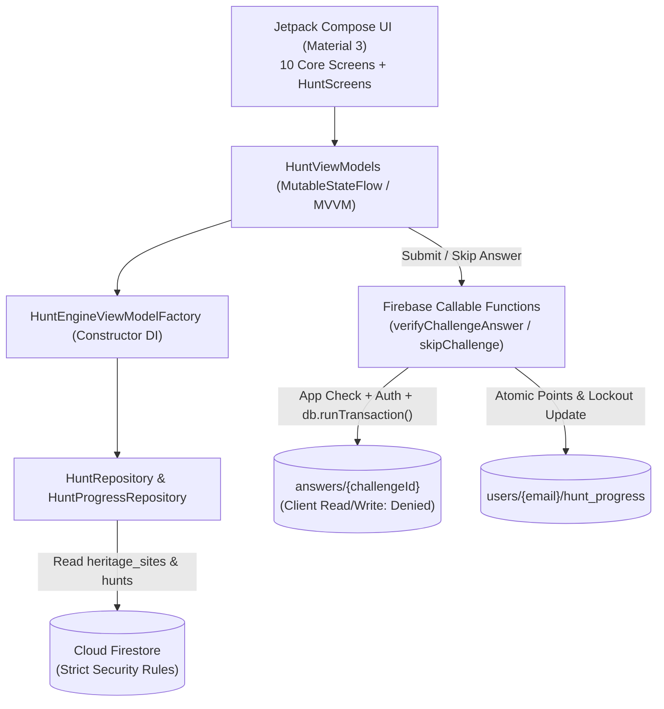

# Itihasa — Heritage Discovery & Interactive Learning Platform

An Android heritage exploration application built with **Kotlin** and **Jetpack Compose**, backed by **Firebase Auth**, **Cloud Firestore**, and **Cloud Functions**. It combines **Clean Architecture** and **MVVM** with server-authoritative challenge verification, anti-replay protections, and escalating brute-force lockouts.

---

## Architecture Overview



---

## Key Engineering Highlights (Verified in Source)

### 1. Clean Android Architecture & Compose UI
* **Package Structure (`app/src/main/java/com/example/itihasa/`)**: Modular separation across `data/` (`model`, `repository`), `di/` (`HuntEngineViewModelFactory.kt`), `engine/` (`core`, `data`, `domain`, `ui/compose`), and `ui/` (`theme`, `viewmodel`, screens).
* **UI Modules**: **10 core Compose screen files** (`SplashScreen`, `OnboardingScreen`, `LandingScreen`, `AuthScreen`, `MainDashboard`, `HomeScreen`, `MarketScreen`, `BoardScreen`, `ProfileScreen`, `CommonUi`) plus dedicated hunt views (`HuntListScreen`, `HuntScreen` in `HuntScreens.kt`).
* **State & DI**: Reactive state via `MutableStateFlow` / `asStateFlow()` in `HuntViewModels.kt` (`viewModelScope.launch`) paired with manual constructor dependency injection (`HuntEngineViewModelFactory`).

### 2. Challenge Engine Domain Model (`engine/domain/`)
* **5 Interaction Types**: `TEXT`, `NUMBER`, `VISION`, `GPS`, `MULTIPLE_CHOICE` *(with `TEXT`, `MULTIPLE_CHOICE`, and `NUMBER` verified server-side in `functions/index.js`)*.
* **5 Challenge Goals**: `DISCOVER_SYMBOL`, `OBSERVE_PATTERN`, `COUNT_OBJECT`, `COMPARE`, `VERIFY_LOCATION`.
* **4 Difficulty Tiers**: `EASY`, `MEDIUM`, `HARD`, `EXPERT`.

### 3. Server-Authoritative Security & Anti-Cheat (`firestore.rules` & `functions/index.js`)
* **Zero Client Answer Exposure**: `firestore.rules` enforces `allow read, write: if false;` on `heritage_sites/{siteId}/hunts/{huntId}/challenges/{challengeId}/answers/{challengeId}` so challenge solutions cannot be read by clients.
* **Tamper-Proof Progress**: Clients can read their own `hunt_progress` (`isOwner(email)`), cannot delete records (`allow delete: if false;`), and cannot mutate **`5` protected fields** directly (`earnedPoints`, `currentChallengeIndex`, `completedChallengeIds`, `failedAttempts`, `lockedUntil`).
* **Atomic Cloud Functions (`2` Callable Functions)**:
  * `verifyChallengeAnswer`: Enforces Firebase Auth + App Check (in production), verifies challenge ordering (`currentChallengeIndex`), blocks duplicate completions (`ALREADY_COMPLETED`), validates answer formats inside `db.runTransaction()`, and applies **escalating rate-limit lockouts**:
    * **5+ consecutive failures** → **30-second lockout**
    * **10+ consecutive failures** → **5-minute lockout**
  * `skipChallenge`: Transactionally verifies `isOptional` before advancing `currentChallengeIndex`.

---

## Tech Stack (Verified in `gradle/libs.versions.toml` & `app/build.gradle.kts`)

* **Language & Build**: Kotlin `2.2.10`, Android Gradle Plugin `9.2.1`, Java `11`, `minSdk 24` / `targetSdk 36` / `compileSdk 36`
* **UI & Media**: Jetpack Compose BOM `2026.02.01`, Material 3, Coil Compose `2.6.0`
* **Backend & Auth**: Firebase BOM `33.9.0` (`firebase-auth`, `firebase-firestore`, `firebase-functions`), Credential Manager `1.2.2`, Google ID `1.1.1`, Play Services Auth `21.2.0`
* **Location**: Google Play Services Location `21.3.0`
* **Serverless & Rules**: Node.js Cloud Functions (`functions/index.js`), `@firebase/rules-unit-testing`

---

## Setup & Local Development

1. **Firebase Configuration**:
   Place your own `google-services.json` inside `app/` *(avoid committing production/real project files publicly)* and configure Firebase Auth, Cloud Firestore, and App Check.
2. **Deploy Security Rules & Cloud Functions**:
   ```bash
   firebase deploy --only firestore:rules,functions
   ```
   See [docs/HUNT_FIRESTORE_SCHEMA.md](docs/HUNT_FIRESTORE_SCHEMA.md) for collection paths and validation fields.
3. **Run Android App**:
   Open in Android Studio (JDK 11+, Android SDK 36) and run the `app` configuration, or build via `./gradlew assembleDebug`.

---

## Verification & Automated Tests

This repository includes **7 verified automated tests** across Android and Firestore security rules:

* **Android Engine Unit Tests (`3` tests in `HuntEngineTest.kt`)**:
  * `textValidatorTrimsWhitespaceAndIgnoresCase`
  * `numberValidatorAcceptsValueWithinTolerance`
  * `correctAnswerAdvancesTheHuntAndAwardsPoints` (using `MockAnswerVerifier`)
  ```bash
  ./gradlew testDebugUnitTest
  ```
* **Firestore Security Rules Tests (`4` tests in `test/rules.test.js`)**:
  * Authenticated read access on heritage sites & challenges
  * Strict read denial on secret `answers` documents
  * Owner-only read & unauthenticated denial on `hunt_progress`
  * Cross-user read isolation on `hunt_progress`
  ```bash
  cd test && npm test
  ```
